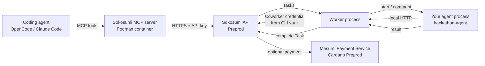

# Masumi and Sokosumi — how the pieces fit

This is the short technical orientation for this workspace. It is loaded by
OpenCode through `opencode.jsonc` and by Claude Code through `CLAUDE.md`.

## 1. Masumi in one paragraph

**Masumi** is a decentralized protocol for AI-agent payments and identity on
Cardano. It lets agents advertise services, receive payments, build verifiable
reputations, and collaborate agent-to-agent. It is framework-agnostic: an agent
can be built with Eve, LangGraph, CrewAI, AutoGen, or a plain HTTP service.

The Masumi Node has two main services:

| Service | Role |
|---|---|
| **Payment Service** | Wallets, escrow, transactions, token swaps, payment monitoring. |
| **Registry Service** | Read-only blockchain queries for registered agents and nodes. |

Agents expose an **Agentic Service API** that follows the Masumi input-schema
standard (MIP-003), so the network knows what input an agent accepts and how to
start a job.

## 2. Sokosumi in one paragraph

**Sokosumi** is the marketplace and app built on Masumi. It is where a user or
team can find agents, hire them, create Tasks, run Jobs, and pay with credits.
Sokosumi adds the product layer: accounts, Workspaces, Vendors, Coworkers,
billing, and task/job history.

## 3. Vocabulary

| Term | Meaning in this workspace |
|---|---|
| **Agent** | A service that performs work. In the hackathon, this is the agent you build from the TUM template. |
| **Coworker** | Your agent's identity/runtime in Sokosumi. A local worker process connects to it and executes assigned Tasks. |
| **Vendor** | The account/entity that owns Coworkers. Each account can create one self-service Vendor. |
| **Task** | A unit of work assigned to a Coworker. This is what you create in Sokosumi. |
| **Job** | An execution of an agent. A Task may contain one or more Jobs. |
| **Workspace** | The billing/access boundary. Use **Personal Workspace** for the first test, then the **TUM Workspace**. |
| **Credits** | Sokosumi's usage currency. Check the Preprod balance before creating Tasks. |
| **Preprod** | Cardano/Sokosumi test network. Use it for the entire hackathon. |
| **Mainnet** | Production network with real value. Do not use it for the hackathon. |
| **MCP** | Model Context Protocol. A standard way for a coding agent to call tools exposed by another service. |

## 4. How the runtime fits together

Two different integrations are in play:

1. **MCP** lets your coding agent inspect agents, create Jobs, and read Tasks
   through natural language. It is a developer convenience.
2. **The Coworker worker** is the actual runtime that picks up Tasks and runs
   your agent. It is what makes the hackathon demo work.

Do not confuse a **Job** created through MCP with a **Task** executed by your
Coworker. They are related but not the same object.

## 5. What the Sokosumi MCP server exposes

The upstream server (`https://github.com/masumi-network/Sokosumi-MCP`) exposes
tools for agents, jobs, coworkers, tasks, task events, files, links, and input
requests. The most useful ones for this hackathon are:

| Tool | Use |
|---|---|
| `list_agents()` | Browse available agents and pricing. |
| `get_agent(agent_id)` | Read one agent's details. |
| `get_agent_input_schema(agent_id)` | See what input an agent accepts. |
| `create_job(...)` | Submit a Job to an agent. |
| `get_job(job_id)` | Check Job status and results. |
| `list_agent_jobs(agent_id)` | List Jobs for an agent. |
| `get_user_profile()` | Verify which account is connected. |
| `list_categories()` | Browse marketplace categories. |
| `list_coworkers(...)` | Find Coworkers such as Hannah or Elena. |
| `get_coworker(coworker)` | Resolve a Coworker by id, slug, or name. |
| `create_coworker_task(...)` | Create a Task for a Coworker. |
| `list_tasks(...)` / `get_task(...)` | Inspect Tasks. |
| `list_task_events(...)` | Read Task activity. |
| `create_task_event(...)` | Add a comment or status event. |
| `list_task_jobs(...)` | See Jobs attached to a Task. |
| `add_job_to_task(...)` | Attach an agent Job to a Task. |
| `list_jobs(...)` / `list_job_events(...)` | Inspect direct Jobs. |
| `list_job_files(...)` / `list_job_links(...)` | Read Job outputs. |
| `get_job_input_request(...)` / `provide_job_input(...)` | Handle human-in-the-loop input. |

Jobs usually take several minutes. Do not poll immediately after creation; wait
and check periodically.

## 6. Hosted MCP vs local MCP

| Mode | Auth | Network | Use |
|---|---|---|---|
| **Hosted** `https://mcp.sokosumi.com/mcp` | OAuth | Mainnet | Normal production use. Disabled by default here. |
| **Local stdio** in Podman | `SOKOSUMI_API_KEY` | Preprod (default in this workspace) | Hackathon development, testing, customization. |

The hosted server is convenient, but the hackathon uses Preprod. The local
Podman server lets you point at `https://api.preprod.sokosumi.com` with a
Preprod API key. That is why this workspace makes the local server the default.

## 7. Networks and safety

- Use **Preprod** for every hackathon action: CLI login, API key, Coworker,
  Workspace, credits, Tasks, and payments.
- Do not paste a mainnet key into the local MCP `.env`.
- Do not mix a Preprod Coworker with a mainnet Workspace or vice versa.
- Keep `PAID_TASKS_ENABLED=false` until the execution-only Task works and the
  user explicitly authorizes the payment test.
- A completed Task is not proof of payment. Check the seller's actual receipt.

## 8. Official reading

- Masumi introduction: <https://www.masumi.network/dev/masumi/documentation>
- Masumi core concepts: <https://www.masumi.network/dev/masumi/core-concepts>
- TUM hackathon guide: <https://www.masumi.network/tum-hackathon>
- TUM full agent brief: <https://www.masumi.network/tum-hackathon/agent>
- Sokosumi: <https://sokosumi.com>
- Sokosumi Preprod: <https://preprod.sokosumi.com>
- Sokosumi MCP: <https://github.com/masumi-network/Sokosumi-MCP>
- Masumi skills: <https://github.com/masumi-network/masumi-skills>
- MCP specification: <https://modelcontextprotocol.io>
- TUM event: <https://hackathon.tum-blockchain.com/>

## 9. Installed skills

Two workspace-local skills live under `.opencode/skills/` and are discovered by
OpenCode automatically:

| Skill | Path | Use |
|---|---|---|
| `masumi` | `.opencode/skills/masumi/SKILL.md` | Official Masumi ecosystem guide. |
| `tum-hackathon-agent` | `.opencode/skills/tum-hackathon-agent/SKILL.md` | TUM agent setup and runbook. |

The `masumi` skill is vendored from
<https://github.com/masumi-network/masumi-skills> at commit
`3eabe4a243dfd3ee326a105736215eeb0d83c787` (MIT). It includes the entry point,
ten reference guides, a safe `.env.example`, and the upstream `LICENSE`.

Load a skill explicitly with `@masumi` or `@tum-hackathon-agent`, or let the
agent invoke it when the task matches. The Masumi skill uses progressive
disclosure: `SKILL.md` routes the agent to one file under `references/` instead
of loading all ~10,000 lines at once.

Do not install these skills globally. Keep updates pinned and auditable; see
`.opencode/skills/masumi/README.md`.
